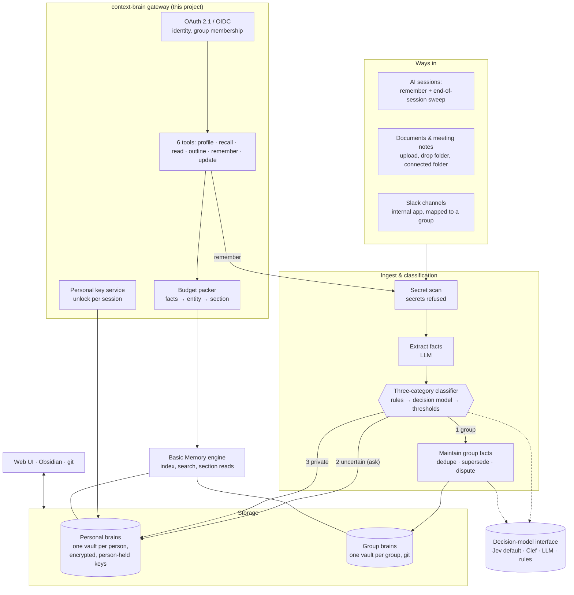

# Decision: how to build context-brain

| | |
|---|---|
| **Status** | Draft for engineering review |
| **Date** | 2026-11-01 |
| **Decision** | Build a thin open-source gateway and ingest pipeline on Basic Memory's markdown format. Every person gets an encrypted personal brain; group brains are filled automatically under a three-category sharing principle. Decisions are made by a pluggable decision model, Jev by default. |
| **Delivery plan** | [plan.md](plan.md) |

*The landscape moves fast. Versions, prices and availability were checked in October and November 2026. Anything marked **(unverified)** comes from vendor or third-party claims we could not confirm.*

---

## 1. Summary

- **What it is:** a memory and context engine that gives every person a **private brain** and every group a **shared brain**. Any MCP-capable AI client can use both, within a token budget.
- **The foundational principle (§2):** every piece of information is sorted into one of three categories:
  - **Group:** definitely relevant to the group. It goes to the group brain automatically.
  - **Uncertain:** we don't know. The author is asked for consent before it is shared.
  - **Private:** definitely personal. It never leaves the person's brain.

  The original author can edit or pull back anything they contributed to a group, at any time. No curator or review queue sits in the flow, because the brain is only valuable if it fills itself as people work.
- **Capture as people work.** The main inputs are:
  - AI assistants saving durable facts during normal sessions;
  - documents and meeting notes people provide;
  - Slack channels connected to a group.
- **Personal brains** are part of the central deployment but **isolated and encrypted with keys only the person controls**, so the operating organisation cannot read them at rest or in backups (§7.3 sets out exactly what is and isn't guaranteed).
- **Build vs adopt:** we adopt **Basic Memory** (open source) as the storage format and engine, and build a **gateway** around it. The gateway provides:
  - identity, isolation and encryption
  - six model-facing tools with a token budget
  - the ingest and classification pipeline
  - deploy recipes for personal, organisation and community hosting.
- **Decision model:** every classification goes through a **decision-model interface**. **Jev** is the default; Clef, any compatible decision API, an LLM or simple rules can be plugged in per judgment.
- **Go/no-go gate** after phase 1. The gate is mostly about whether automatic classification is accurate enough to trust ([plan, Gate 1](plan.md#gate-1-is-automatic-classification-trustworthy)).

## 2. Foundational principle: three categories of information

Everything the brain learns is about someone and was contributed by someone. Before it is stored, every item is placed in exactly one category **relative to the person who contributed it (the author)**.

| Category | Meaning | What happens | Author's control |
|---|---|---|---|
| **1. Group** | Definitely relevant to a group the author belongs to, and not personal or sensitive | Goes to that group's brain **automatically**, attributed to the author | Notified in a digest; can edit or retract at any time |
| **2. Uncertain** | Might belong to a group, might be private | Stored in the author's **personal** brain, and the author is **asked for consent** to share it | Yes → becomes a group item (category 1 rules apply from then on). No or no answer → stays private. |
| **3. Private** | Definitely personal or sensitive | Stored only in the author's personal brain. **Never** shared, never suggested. | Full control in their personal brain |

**Rules that follow from the principle:**

1. **When in doubt, move towards private.** Classification errors must fail safe:
   - unsure between 1 and 2 → choose 2;
   - unsure between 2 and 3 → choose 3.

   Thresholds are deliberately asymmetric (§7.6).
2. **Category 3 rules beat category 1 rules.** If a sensitivity rule fires, nothing else can push the item into a group, not even an explicit instruction. In that case the author is told why.
3. **The author always keeps control of their contribution.** Editing a group item they authored, or retracting it, takes effect immediately in the group brain and its index. If another author independently asserted the same fact, it stays under that author's name.
4. **No human gatekeeper.** There are no curators, approval queues or review steps between a contribution and the group brain. The only human decision in the flow is the author's consent for category 2.
5. **Every decision is explainable.** Each item records its category, the rule or rubric scores that put it there, and the decision model that scored it. Authors can see why something was shared.

The rest of the design (capture, storage, encryption, classification, tools and metrics) is built around these rules.

## 3. Problem and goals

AI assistants now do real work, but the context they work from is fragmented:

- Each vendor's memory is **per user and per product**. Nothing learned in one tool is visible to another tool or to a colleague.
- **Group knowledge has no home that models can read.** This means decisions, constraints, conventions, owners and recent changes. People re-explain it in prompts, or each agent rediscovers it.
- Loading a whole wiki or a long `CLAUDE.md` is **token-expensive** and hurts answer quality.
- **Nobody will curate a brain by hand.** Knowledge bases decay because maintaining them is extra work. The brain has to fill and tidy itself while people work.
- **People won't adopt a brain that feels like surveillance.** Their personal context must be visibly theirs.

**Goals:**
- One private brain per person and one shared brain per group, usable from any MCP-capable AI client.
- Capture happens as a side effect of normal work, with no curation step.
- Models retrieve small, relevant, attributed facts within a stated token budget.
- People own their contributions: they can read, edit, retract and export them.
- It works for one person, a team, and an organisation of hundreds, without forking the code.

**Non-goals for v1:**
- A hosted multi-tenant SaaS. The design must not block one, but we are not building it.
- A chat UI or agent framework. The brain is a service that other tools call.
- Reading email, direct messages or whole-workspace data. Capture is limited to the channels in §7.

## 4. Requirements

R1–R7 and R10 are must-haves. R8–R9 are strong preferences.

| # | Requirement | What "good" looks like |
|---|---|---|
| R1 | **Group brain** | Many people feed one brain that builds up facts about the group. Every fact records its author and source. |
| R2 | **One brain per person, any AI** | The same personal brain and group brains from Claude (web, desktop, mobile, Code), ChatGPT, Gemini, Cursor, other coding agents and local models. |
| R3 | **Built for models, token-cheap** | Facts of about 20–40 tokens first, then the entity, then the source section. Every lookup has a token budget, and the tool definitions stay small. |
| R4 | **Human interface** | People can browse, edit and retract what they contributed, and browse what their groups know, in a web UI or Obsidian. Edits and retractions reach the search index. |
| R5 | **Isolated, selectable contexts** | Each person has a personal brain, plus group contexts such as `team-payments` or `org-handbook`. A session attaches one or several. Access is **enforced**, not tagged. |
| R6 | **Open and portable** | Open-source code; data is plain markdown that can be exported. No required proprietary service. |
| R7 | **Captures as people work** | AI sessions, provided documents, meeting notes and Slack channels feed the brain without a curation step. Duplicates are merged, and superseded or disputed facts are marked. |
| R8 | **Three-category sharing** | Every item is classified as group, uncertain or private (§2). Group items flow automatically, uncertain ones need consent, and private ones never move. Sensitive data never reaches a group. |
| R9 | **Deployable at three scales** | Personal, organisation and community deployments from the same code, differing only in configuration. |
| R10 | **Personal brains are private from the operator** | Personal brains are encrypted with keys only the person controls; the organisation cannot read them at rest or in backups. |

## 5. What the research says

### 5.1 Token efficiency

- **Benchmarks mostly come from vendors, and they disagree.** For example:
  - Mem0's paper on LoCoMo: full context scored 72.9% at about 26k tokens per query; Mem0 scored 66.9% at about 1.8k; Zep scored 66.0% at about 3.9k.
  - Letta's plain agent with file tools over the raw text scored 74%.
  - The independent MemDelta benchmark found verbatim retrieval close to full context (47.2% vs 49.8%). Changing only the embedding model moved accuracy by 6 points.
- **Takeaway:** simple retrieval over the original text, split into sections, is a strong baseline. Fact extraction adds cost and errors. Adopt it where our own evaluation shows a gain, and always keep the source alongside the fact.
- **What actually cuts tokens:**
  - small retrieval units (a fact is about 20–40 tokens)
  - section-level reads instead of whole pages
  - hybrid keyword and vector search with reranking
  - a hard token budget per lookup
  - progressive disclosure: profile, then outline, then section, then page
  - few, short tool definitions.

### 5.2 Facts and graphs versus wiki prose

- **A graph is not automatically better.** *Does Memory Need Graphs?* (ACL 2026) found:
  - Graphs help only when they are built well. Entity nodes with descriptions helped; edges based on similarity hurt.
  - Matching a query to entities beats matching it to triples.
  - Keeping the raw text **alongside** the extracted facts improved retrieval.
  - Building the graph took about 7× longer than a flat index.
- **Token cost depends on the design.** Per query:

  | System | Tokens per query |
  |---|---|
  | HippoRAG 2 | ~1k |
  | LightRAG | 5k–100k |
  | Microsoft GraphRAG (global) | ~330k |

- **Conclusion: keep markdown, but make it fact-shaped.** Basic Memory stores observations (`- [category] fact #tag`) and typed relations (`- depends_on [[Ledger Service]]`) inside ordinary notes. So the graph *is* the markdown, and people can edit it.

### 5.3 Human interface

- **Obsidian is the best editor for markdown vaults,** but it has **no access control inside a vault**. So the unit of isolation is one vault per context, with the gateway enforcing access.
- **A web UI is required anyway.** Personal brains are encrypted (§8.2), so most people will see "what I contributed, where it went, and why" in a web UI. Obsidian remains available for group contexts and for power users.

### 5.4 Client reach

- **Remote MCP over HTTPS with OAuth 2.1** is the one surface that every major client accepts: claude.ai, ChatGPT (Business and Enterprise), Gemini, Cursor, Claude Code, Gemini CLI, Open WebUI and LibreChat.
- **Clients don't save or recall on their own.** Each needs a short instruction ("call `profile` and `recall` first; call `remember` when you learn something durable"), or a hook where the harness supports one (Claude Code does).

### 5.5 Decision models

Two non-generative decision models now exist. They take *state* plus typed questions and return probabilities, not text.

| | Jev (TypeSafe) | Clef (Cloudflare) |
|---|---|---|
| Released | Early access since Sep 2026 | 1 Oct 2026 |
| Weights | Hosted only | Open weights, Apache-2.0 (Clef and Clef-flash), also hosted on Workers AI |
| Question types | Probability that a statement is true ("Noul"), choice, score | Same; Cloudflare describes it as Jev-API compatible |
| Context | 32k tokens of state per question | 64k |
| Price | $0.042 per million input tokens, output free | Hosted pricing not stated; free to self-host |
| Speed (vendor numbers) | 524 ms median | 209 ms (Clef), 39 ms (Clef-flash) median |

All performance figures are each vendor's own **(unverified)**. Because both share a request shape, one adapter can serve both (§7.7).

### 5.6 Slack

- Slack's API terms restrict LLM training, bulk export and persistent indexes for apps **distributed to other organisations**. Since mid-2025, those apps also face tight rate limits on reading channel history.
- **Internal, customer-built apps are not affected by the rate limits.** An app used only inside its own workspace falls outside the third-party data restrictions. The terms imply this rather than stating it for every clause.
- **Therefore:** each deployment installs **its own internal Slack app** in its own workspace. A hosted multi-tenant offering would need to go through the Slack Marketplace, which is another reason it is a non-goal.

## 6. Options compared

Key: ● meets · ◐ partly or needs work · ○ no · ? unknown. None of the existing options meets R8 or R10, so those columns are left out of the table.

| Option | Kind | R1 Group | R2 Any AI | R3 Tokens | R4 Human UI | R5 Contexts | R6 Open | R7 Capture | Verdict |
|---|---|---|---|---|---|---|---|---|---|
| **Basic Memory (self-hosted)** | OSS (AGPL), markdown + graph | ◐ no auth/ACL | ◐ needs OAuth front | ● observations, section reads with `max_tokens` | ● Obsidian | ◐ projects, no ACL | ● | ◐ format, no extractor | **Base layer** |
| Basic Memory Cloud/Teams | Commercial, ~$15–19/seat | ● roles per project | ● | ● | ◐ | ● | ◐ same files | ◐ | Managed option; fails R10 |
| mcp-memory-service | OSS (Apache) | ◐ tags | ● OAuth + DCR | ◐ | ◐ dashboard | ◐ tags | ● | ◐ | Quick prototype |
| Memlord | OSS (AGPL), very small | ● shared workspaces | ● OAuth 2.1 | ◐ | ◐ | ● | ● | ◐ | Gateway reference |
| Hindsight | OSS (MIT) | ◐ bearer key | ◐ no OAuth | ● budgeted recall | ○ opaque store | ● | ◐ Postgres | ● | Best engine, fails R4 |
| Graphiti / Zep | OSS (Apache), temporal graph | ○ no isolation | ◐ no auth | ● facts as edges | ○ | ◐ | ◐ Neo4j | ● valid-from/to | Copy its fact model |
| Cognee | OSS (Apache), knowledge graph | ● multi-tenant | ◐ | ◐ | ○ | ● | ◐ heavy | ● | Too heavy |
| Mem0 | OSS (Apache) | ◐ | ○ no MCP self-hosted | ● ~1.8k/query | ○ | ◐ | ◐ | ● | Avoid |
| HippoRAG 2 | Research code | ○ | ○ | ● ~1k/query | ○ | ○ | ● | ● | Borrow retrieval idea |
| qmd | OSS (MIT), search | ○ | ◐ no auth | ● hybrid + rerank | ● | ◐ | ● | ○ | Search component |
| LLM-wiki tools (Karpathy pattern) | OSS | ○ | ◐ | ○ index + whole pages | ● | ◐ | ● | ◐ ingest/lint | Borrow layout and lint |
| flow (Facets) | OSS (MIT), alpha | ○ single user | ◐ Claude Code/Codex | ◐ | ◐ terminal | ◐ | ● | ◐ capture during and after sessions | Borrow capture ideas |
| Outline / Docmost | Self-hosted wiki + MCP | ● | ● | ◐ page-level | ● | ● permissions | ◐ DB storage | ○ | Alternative UI |
| Supermemory | Commercial | ● spaces | ● MCP + extension | ◐ vendor claims | ◐ web app | ● | ○ closed | ● | Best managed product; fails R6, R10 |
| MemoryPlugin, Plurality Context Flow | Commercial | ◐ | ● many platforms | ◐ | ◐ | ● | ○/◐ | ◐ | Not for orgs |
| Notion MCP + memory | Commercial | ◐ memories per user | ◐ | ◐ | ● | ● | ◐ proprietary | ◐ | Only if already on Notion |
| Vendor-native memory (Claude, ChatGPT) | Built in | ◐ | ○ one vendor | ◐ | ◐ | ◐ | ○ | ◐ | Stopgap only |

**Ruled out:**
- Letta and Khoj: agents, not memory layers. We borrow Letta's "core memory block" idea for `profile`.
- MemOS, memU, Memobase, A-Mem, LangMem, the reference MCP memory server: research projects, coding-focused, stalled, or toys.
- Zep and Mem0 cloud APIs: developer APIs, not a brain people can edit.

**Realistic directions:**

| Direction | Build effort | Must-haves met | Main risk | Lock-in |
|---|---|---|---|---|
| **A. Open source + thin build (chosen)** | A gateway, an ingest and classification pipeline, encryption, connectors, deploy recipes | All, once built | We own security and uptime; classification quality is on us | None: markdown in git |
| B. Basic Memory Cloud/Teams | Near zero | R1–R5; R6 partly; not R8 or R10 | No three-category sharing; vendor can read data | Low: same files |
| C. Supermemory | Near zero | R1, R2, R5 | Closed engine; no R8 or R10 | High |

Only A meets the three-category principle and the personal-privacy requirement.

## 7. Architecture

### 7.1 Overview



### 7.2 Ways in (ingestion)

**The aim is to capture as much as possible as people work, with no extra effort.** Every way in feeds the same pipeline: secret scan, fact extraction, three-category classification, then storage.

| Way in | How it works | Priority | On by default |
|---|---|---|---|
| **AI saves as it works** ("scoop") | The model calls `remember` whenever a durable fact comes up: a decision, constraint, preference, owner or change. The client instruction or hook tells it to do this proactively. Each save returns a short receipt the model can show. | **Primary** | Yes |
| **Documents and meeting notes** | Upload in the web UI, drop into a context's `raw/` folder, or connect a folder (e.g. a Drive folder where meeting transcripts land). Facts are extracted and the source is kept, so answers can cite it. | **Primary** | Yes for uploads; connected folders are switched on per group |
| **Slack channels** | The deployment's internal Slack app reads the channels it is **invited to**. Each channel maps to one group context. | **Primary** | Per channel, switched on by inviting the app |
| **"Remember this"** | The person asks explicitly, optionally naming a group ("remember for team-payments"). | Supporting | Yes |
| **End-of-session sweep** | When a session ends, the transcript is re-read for facts the model didn't save. This works where the harness exposes it (e.g. Claude Code hooks); elsewhere the person uploads it. | Supporting | Per person, opt-in |
| **Direct edits** | Edits in the web UI, in Obsidian (group contexts) or in git. Treated as authoritative; only the secret scan runs. | Supporting | Yes |
| **API and CLI** | For automation, such as a build pipeline posting release notes. Uses a service identity limited to one group. | Supporting | No, needs a key |

**Never ingested:** email, Slack direct messages and private channels the app isn't invited to, anything from a workspace-wide crawl, and AI chat histories the person didn't send.

**Who is the author** decides which personal brain an item belongs to, and who can retract it:

| Source | Author |
|---|---|
| AI session, "remember this", sweep | The signed-in person |
| Uploaded document | The uploader |
| Meeting notes | The person who uploaded or connected them. Statements attributed to a speaker in the notes are also tagged with that speaker, who can retract them. |
| Slack message | The message's sender |
| API | The service identity, owned by the group |

**Group sources are handled slightly differently.** Slack channels, meeting folders connected to a group, and documents dropped into a group context already have a defined audience: that group. For these, the classifier doesn't ask whether something is group or personal. It only removes **category 3** content (sensitive or personal) and noise. Category 3 content from a group source is **discarded**, not stored in anyone's personal brain.

### 7.3 Personal brains: isolation and encryption

Every person gets a personal brain inside the central deployment. It is fully isolated and controlled only by them.

**Isolation:**
- One vault per person.
- Only that person's identity can read or write it. There is no admin role over personal brains, and no "view as user" feature.
- Group membership never grants access to a personal brain.

**Encryption**, based on keys the person holds:
- **Keys.** Each person has an encryption key pair. The private key is wrapped (encrypted) by a key only the person can produce: a passkey (via the WebAuthn PRF extension) or a passphrase. There is also a **recovery key** the person stores themselves. The organisation's key management never holds an unwrapped copy.
- **Writes without unlocking.** New personal items (category 2 and 3) are encrypted to the person's **public** key as they arrive, so capture keeps working while the person is offline.
- **Reads and maintenance need an unlock.** When the person connects a client, the OAuth sign-in includes an unlock step, and the client's token carries the key needed to unwrap their private key for that session. On the server, the personal vault and its index are decrypted **only in memory**, only while a session is active, and only in an engine instance dedicated to that person. Pending personal items are processed at the same time (dedupe, consent prompts).
- **At rest and in backups:** ciphertext only. This includes the search index, which is kept encrypted per person.
- **Editing:** the web UI decrypts within the session. For Obsidian access to a personal brain, a sync client decrypts on the person's own device (phase 4).

**What this guarantees, and what it doesn't:**

| Threat | Protected? |
|---|---|
| An org admin reads stored files, the database or backups | **Yes.** They hold only ciphertext. |
| An org admin uses an admin feature to view someone's brain | **Yes.** No such feature exists. |
| A stolen disk or leaked backup | **Yes** |
| An operator **modifies the running server** to capture plaintext while the person is active | **No.** Plaintext exists in memory during processing. Mitigations: open-source code, reproducible builds, and an optional **confidential-computing** mode (AMD SEV-SNP / Intel TDX with attestation) for organisations that need this guarantee. |
| The LLM and decision-model providers see content while processing it | **Yes, they do.** Each provider is listed as a data processor. Personal-brain judgments and extraction can be routed to self-hosted models (e.g. open-weight Clef, a local LLM). |
| The person loses their passkey and recovery key | **Their personal brain is lost.** This is the price of the organisation being unable to read it. |

**Leaving the organisation:** the person can export their personal brain, decrypted, as markdown. The organisation deletes the ciphertext according to its retention policy. The person's contributions to group brains stay, attributed to them.

### 7.4 Group brains: vault layout and note format

```
<group-context>/
  AGENTS.md        # conventions for this context (read by ingest)
  policy.md        # purpose, scope, examples in and out (used by the classifier)
  profile.md       # ~500-token always-loaded summary, compiled by ingest
  index.md, log.md # Karpathy-style index and change log
  raw/             # sources: documents, meeting notes, Slack digests
  inbox/           # items awaiting ingest
  wiki/            # entity notes: people, services, projects, decisions
```

An entity note (illustrative; the exact attribution syntax is fixed in phase 1 so it stays valid Basic Memory):

```markdown
---
title: Orders API
type: service
---
# Orders API
Public API for creating and tracking orders. Owned by the payments team.

## Facts
- [constraint] Idempotency keys expire after 24 hours #api (by: alice · src: [[raw/2026-10-12-design-review#Retries]] · from: 2026-10-12 · cat: 1/rule:group-source)
- [decision] Pagination is cursor-based; offset pagination is deprecated (by: bob · from: 2026-09-01 · cat: 1/rubric 0.96)

## Relations
- owned_by [[Payments Team]]
- depends_on [[Ledger Service]]

## Disputed
- [sla] p99 latency target is 300 ms (by: carol) vs 500 ms (by: dave)
```

Every fact records its author, source, valid-from/to dates, and **why it was shared** (the rule, or the rubric score). Conflicting claims are recorded under `## Disputed`, with both attributed, rather than one overwriting the other.

### 7.5 Model-facing tools

Six tools, about 800 tokens of definitions. Longer guidance lives in an on-demand `man` resource.

```
profile(contexts?)                       → ~500-token core block per attached context (personal + groups)
recall(query, contexts?, budget_tokens=1500, detail=facts|snippets|sections)
                                         → ranked, attributed hits packed to the budget; omitted count + cursor
read(id, max_tokens?)                    → one section, cut at a heading boundary, with where to continue
outline(id | context)                    → headings and their token sizes
remember(text, context?, source?)        → classified on arrival; returns a receipt saying where it went
                                           (group X / kept private / "may be useful to group X: share?")
update(ids, action, text?)               → share | keep_private (answers a consent prompt)
                                           edit | retract (own contributions, personal or group)
```

The **consent prompt** for category 2 reaches the person in two ways:
- **Inline:** `remember`'s receipt asks the model to check with the person ("This may be useful to team-payments. Share it?"), and the model calls `update` with the answer.
- **Batched:** unanswered prompts appear in a digest in the web UI, with an optional Slack DM.

Every answer can be saved as a standing rule ("always share API constraints with team-payments"), so the questions dwindle over time.

### 7.6 The three-category classifier

The classifier runs on every item and implements §2 in four layers.

**Layer 1: fixed rules.** These are deterministic, run first, and no model can override them.

- **Forced category 3:**
  - credentials and secrets (refused entirely);
  - health, family and personal finances;
  - pay, performance and HR matters;
  - personal contact details;
  - claims about a named person's behaviour, performance or private life;
  - topics on the person's own "always private" list.
- **Forced category 1, subject to the category 3 rules:**
  - the person explicitly addressed a group ("remember for team-payments");
  - the item came from a group source (§7.2);
  - the item matches one of the person's own standing share rules;
  - the item matches the group's `policy.md` "always group" types (e.g. decisions about services the group owns).
- **Order:** category 3 rules win over category 1 rules. If both fire, the person is told the item stayed private and why.

**Layer 2: rubric questions,** asked of the decision model through the interface in §7.7.

| Dimension | Question | Type |
|---|---|---|
| Scope | Which of the person's groups does this fall under, judged against each group's `policy.md`? Or none? | Choice |
| Subject | Is this about the author's personal life, preferences or habits rather than the group's shared work? | Probability |
| Sensitivity | Public, internal, confidential, personal-sensitive, or secret? | Choice |
| Other people | Does it make claims about a named person's behaviour, performance or private life? | Probability |
| Usefulness | How likely are other group members to need this in the next 3 months? (none / low / medium / high) | Score |
| Durability | Will it still be true and useful in 30 days? | Probability |
| Novelty | Does the group already know this? (asked against the top matching facts) | Probability |

**Layer 3: mapping scores to a category,** using asymmetric thresholds. These are the proposed starting values, tuned per group.

| Step | Condition | Result |
|---|---|---|
| 0. Worth keeping? | Durability < 0.5 and usefulness to the author is low | **Drop.** Not stored anywhere. |
| 1. Private? | Sensitivity ≥ personal-sensitive at p ≥ 0.2, **or** other-people ≥ 0.3, **or** subject ≥ 0.5, **or** no scope fits | **Category 3** |
| 2. Group? | Scope fits one group at p ≥ 0.9, sensitivity ≤ internal at p ≥ 0.95, subject ≤ 0.1, usefulness ≥ medium, novelty says it's new | **Category 1** |
| 3. Otherwise | — | **Category 2** (ask) |

The private test is deliberately easy to trigger and the group test deliberately hard to pass, so classification errors land on the side of privacy.

**Layer 4: the author's control and learning from it.** There is no curator or approval queue.
- **Category 1 items** are listed in the author's digest ("Shared with team-payments: …"). The author can edit or retract any of them at any time.
- **Category 2 consent answers** and **category 1 retractions** are logged as labels. Retractions are the main signal that auto-sharing got something wrong, and they are used to recalibrate thresholds per group and per decision model.
- **Quality targets** (see the plan):
  - zero sensitive items reaching a group in the test set;
  - at least 98% of auto-shared items never retracted;
  - consent prompts per person stay low enough not to be a nuisance.

### 7.7 Decision-model interface: any model, Jev by default

Every non-generative judgment goes through one interface. That covers the classifier rubric, plus group maintenance: dedupe, entity matching, supersede and contradict, and optionally reranking. Generating text is not a decision-model job: fact wording, summaries and profiles always use an LLM.

**The contract** has three question types:

```
probability(state, statement)          → p(true), confidence
choice(state, question, options)       → distribution over options, confidence
score(state, question, levels)         → distribution over ordered levels, confidence
```

This is the shape Jev's API uses and Clef copies, so one adapter covers both.

**Provider adapters:**

| Adapter | Covers |
|---|---|
| `decision-api` | Any Jev-compatible endpoint: **Jev (default)**, Clef on Workers AI, self-hosted Clef or Clef-flash, future compatible models. Configured by URL and model name. |
| `llm` | Any OpenAI-compatible or Anthropic endpoint, using structured output (and log-probabilities where available) |
| `classifier` | A small trained model, e.g. one fine-tuned on a deployment's own consent and retraction labels |
| `rules` | Deterministic rules, used in layer 1 and as a last fallback |

**Routing per judgment, with fallbacks:**

```yaml
decision_models:
  providers:
    jev:        { kind: decision-api, url: <typesafe endpoint>, model: jev }          # default
    clef-self:  { kind: decision-api, url: http://clef.internal:8080, model: clef-flash }
    llm:        { kind: llm, model: <any> }
  default: [jev, llm]
  routing:
    personal.*: [clef-self, llm]        # e.g. keep judgments on personal content in-house
```

**Calibration.** Confidence measures how sure a model is, not whether it is right. Each provider gets a calibration step per judgment, fitted on labelled data from the public test set and later on the deployment's own consent and retraction labels. That way a threshold such as "p ≥ 0.9" means the same thing whichever model is plugged in.

**Adding a new decision model** means writing an adapter (or none, if its API is Jev-compatible), running the shared test suite, and publishing the results.

**Why Jev is the default:**
- It was the first model built for exactly these typed judgments.
- It returns calibrated probabilities.
- It is cheap ($0.042 per million input tokens). An illustrative workload:
  - about 8 judgments per item, at about 2k tokens each, is about 16k tokens per item;
  - a million items is then about **$670** in judge cost.
- TypeSafe publishes memory, rerank and entity-alignment cookbooks for this kind of work.

**What to weigh before relying on it:**
- Jev is hosted only and in early access. Retention terms are not stated publicly **(unverified)**.
- Under the default config it sees the content it classifies, including personal items.
- Deployments that can't accept that can route personal-brain judgments, or everything, to self-hosted Clef or an LLM they trust, using the configuration above.

### 7.8 Maintaining group facts

Once an item is in category 1, the maintenance step decides how it lands. These decisions also go through the decision-model interface, with conservative defaults instead of a review queue:

| Question | If confident | If unsure |
|---|---|---|
| Is it the same entity as an existing one? | Merge into that note | Create a separate note, linked as "possibly the same as" |
| Is it a duplicate of an existing fact? | Add the author as a co-asserter | Keep both |
| Does it supersede an older fact? | Set `to:` on the old fact | Record both under `## Disputed` |

A scheduled lint pass reports orphans, stale facts and growing dispute lists for each group. It doesn't block anything.

## 8. Hosting profiles

The same container image and configuration schema serve every profile.

| | **Personal** | **Organisation** | **Community (anyone self-hosting)** |
|---|---|---|---|
| Who | One person, maybe a few people | A company: many teams, hundreds of people | Individuals and groups running their own instance |
| Runs on | Laptop (stdio for local clients), plus an optional small VPS or tunnel for web clients | The org's container platform, with public HTTPS ingress for SaaS AI clients | Docker Compose on a VPS or home server; Helm optional |
| Identity | Built-in OAuth, single user | **OIDC to the org's identity provider**; group membership from IdP groups | Built-in OAuth or any OIDC provider |
| Personal brains | One, encryption optional (you are the operator) | Encrypted with person-held keys (§7.3); confidential-computing mode optional | Encrypted with person-held keys |
| Group brains | Optional | One git repository per group, on the org's git host | Local git |
| Slack | Usually not needed | The org's own **internal** Slack app, invited to channels | Optional, as an internal app in their own workspace |
| Meeting notes and documents | Upload or drop folder | Upload; connected folders per group (e.g. where meeting transcripts land) | Upload or drop folder |
| Decision model | Jev by default | Jev under a data-processing agreement, or self-hosted Clef, or the org's LLM, chosen per judgment | Jev by default; self-hosted Clef or an LLM for no external dependency |
| Human UI | Obsidian or web | Web UI; Obsidian and git for group contexts | Web UI or Obsidian |

**Multi-tenant hosting** (one instance serving unrelated organisations) is out of scope for v1. A tenant identifier sits at the top of the context namespace so it can be added later.

## 9. Security, privacy and compliance

- **Access control is enforced at the gateway on every call.** Personal brains are reachable only by their owner, and group brains only by members. Recall never merges results across contexts the caller can't read.
- **Personal brains are encrypted with person-held keys.** §7.3 sets out what that does and doesn't protect against.
- **Stored text is untrusted input.** Facts written by one person reach another person's model, so memory poisoning and prompt injection are real risks. Mitigations:
  - every fact carries its provenance;
  - `recall` output is framed as data, not instructions;
  - classification and secret scanning run on every write;
  - each group has a list of who may write to it.
- **Secrets are refused at the door.** Credentials found by the scanner are never stored anywhere, personal brains included.
- **Retraction and erasure:**
  - A retraction removes the fact from the group vault and its index immediately.
  - **Git history still holds it.** Group repositories therefore get periodic history compaction: commits older than a configurable window are squashed, so retracted content is purged within that window.
  - Content already returned to someone's AI session can't be recalled. This is documented for users.
- **External processors:** every outside service that sees content is declared in config, so a data-protection review can approve it. That covers the decision model, the LLM, embeddings and Slack.
- **Compliance tension:** some organisations need to access employee data on company systems, for e-discovery, legal hold or data-loss prevention. Encrypted personal brains deliberately prevent that. Each organisation's legal team must accept this before deploying, and some may need to disable personal brains or switch to organisation-held keys. That would be a separate, clearly labelled configuration.
- **Audit:** every tool call is logged with its identity, contexts, token count and the IDs returned (not the content). Personal-brain calls log only that a call happened.

## 10. Licensing

- **Basic Memory is AGPL-3.0.** We run it unmodified as a separate process, one instance per unlocked personal brain and one per group, and talk to it over its interface. The gateway is a separate work and can carry a permissive license. Any changes we make to Basic Memory itself would be published under the AGPL, ideally upstream.
- **Proposal:** Apache-2.0 for this repository.
- **Jev** is a proprietary hosted API, used through the generic `decision-api` adapter. **Clef** weights are Apache-2.0. Neither is vendored.
- **Needs confirmation** by the sponsoring organisation's open-source policy owner.

## 11. Risks

| Risk | Likelihood | Impact | Mitigation |
|---|---|---|---|
| Auto-sharing puts something personal into a group | Medium | **High** | Fixed rules first; asymmetric thresholds; retraction any time; zero-leak target on the test set before launch |
| Too many consent prompts, so people ignore them | Medium | High | Standing rules learned from answers; batched digests; prompts per person tracked as a metric |
| Too few items shared, so group brains stay empty | Medium | High | Group sources (Slack, meeting folders) bypass the personal/group question; per-group threshold tuning |
| Fact extraction introduces errors that spread | Medium | High | Sources kept alongside facts; attribution; disputes recorded rather than overwritten; lint |
| Personal-brain key loss | Medium | Medium | Recovery key at enrolment; clear warnings; export |
| Operator compromise of the running server | Low | High | Open-source code, reproducible builds, optional confidential computing |
| Legal teams reject operator-blind personal brains | Medium | Medium | Organisation-held-key mode as an explicit alternative; documented trade-off |
| Decision-model API, pricing or availability changes | Medium | Low–medium | Decision-model interface; per-judgment routing; open-weight fallback |
| One engine instance per unlocked person is costly at scale | Medium | Medium | Measured in phase 2; idle instances evicted; shared engine with per-person encrypted indexes as plan B |
| Slack API terms change | Low–medium | Medium | Internal-app model; Slack is one way in among several |
| Basic Memory changes direction or stalls | Low–medium | Medium | Storage adapter boundary; the format is plain markdown |

## 12. What would change this decision

- **The classifier can't reach the targets.** If phase 1 shows the three-category classifier can't reach zero leaks with a useful share rate, the automatic flow doesn't work. We would then reduce category 1 to fixed rules only (explicit addressing and group sources) and route everything else through consent.
- **A managed product appears** that offers person-held encryption and policy-based sharing. We would then adopt it and keep this repository as the format, the classifier test suite and the recipes.
- **Hindsight gains human-editable storage.** It could then replace Basic Memory behind the storage adapter.

## 13. Questions for reviewers

1. **Automatic sharing.** Is "category 1 goes to the group without asking" acceptable for your teams, given notification plus retraction at any time? What would you need to see from the test set first?
2. **Thresholds.** Are the starting thresholds in §7.6 sensibly cautious?
3. **Operator-blind personal brains.** Is the guarantee in §7.3 strong enough, and is the compliance trade-off in §9 acceptable? Should confidential computing be required, or optional?
4. **Engine instance per person.** Is one engine instance per unlocked personal brain acceptable, or should we design a shared engine with per-person encrypted indexes from the start?
5. **Jev as the default decision model,** with personal-brain judgments routable to self-hosted Clef. What would legal or security need to approve that default?
6. **Group sources.** Is it right that Slack channels and group meeting folders skip the personal/group question and only filter out category 3?
7. **Git per group** with periodic history compaction for retraction: right, or should group brains use a different store?
8. **Licensing.** Apache-2.0 for our code, with Basic Memory kept as a separate AGPL process: any objections?
9. **Name.** "context-brain" is a working name.

## 14. Sources

- Karpathy, [LLM Wiki gist](https://gist.github.com/karpathy/442a6bf555914893e9891c11519de94f) (Apr 2026)
- [Does Memory Need Graphs?](https://arxiv.org/html/2601.01280) (ACL 2026)
- [Mem0 paper](https://arxiv.org/html/2504.19413): LoCoMo token and accuracy figures
- [Letta: benchmarking agent memory](https://www.letta.com/blog/benchmarking-ai-agent-memory)
- [MemDelta](https://arxiv.org/abs/2606.29914), an independent memory benchmark
- [When to use graphs in RAG](https://arxiv.org/pdf/2506.05690) (HippoRAG 2, LightRAG and GraphRAG token costs)
- [Anthropic: writing tools for agents](https://www.anthropic.com/engineering/writing-tools-for-agents)
- [Basic Memory](https://github.com/basicmachines-co/basic-memory): [knowledge format](https://docs.basicmemory.com/raw/concepts/knowledge-format.md), [MCP tools](https://docs.basicmemory.com/reference/mcp-tools-reference), [Teams](https://docs.basicmemory.com/teams/about)
- [Hindsight](https://github.com/vectorize-io/hindsight), [Graphiti](https://github.com/getzep/graphiti), [Cognee](https://github.com/topoteretes/cognee), [Mem0](https://github.com/mem0ai/mem0), [HippoRAG](https://github.com/osu-nlp-group/hipporag), [qmd](https://github.com/tobi/qmd), [mcp-memory-service](https://github.com/doobidoo/mcp-memory-service), [Memlord](https://github.com/MyrikLD/memlord), [flow](https://github.com/Facets-cloud/flow)
- LLM-wiki implementations: [nashsu/llm_wiki](https://github.com/nashsu/llm_wiki), [lucasastorian/llmwiki](https://github.com/lucasastorian/llmwiki)
- Jev / TypeSafe: [docs](https://docs.typesafe.ai/introduction), [OpenRouter overview](https://openrouter.ai/blog/insights/what-is-jev/), cookbooks for [memory](https://docs.typesafe.ai/cookbooks/basic_memory.md), [rerank](https://docs.typesafe.ai/cookbooks/rerank_typesafe.md) and [entity alignment](https://docs.typesafe.ai/cookbooks/entity_alignment.md)
- Clef / Cloudflare: [Introducing Clef](https://blog.cloudflare.com/clef-decision-models/), [weights on Hugging Face](https://huggingface.co/Cloudflare/clef)
- Slack: [API terms](https://slack.com/terms-of-service/api), [rate-limit changes for non-Marketplace apps](https://docs.slack.dev/changelog/2025/05/29/rate-limit-changes-for-non-marketplace-apps)
- WebAuthn: [PRF extension](https://w3c.github.io/webauthn/#prf-extension)
- [Supermemory](https://supermemory.ai/pricing), [Notion MCP](https://www.notion.com/help/notion-mcp)
- Obsidian: [Sync collaboration](https://obsidian.md/help/sync/collaborate), [headless sync](https://obsidian.md/help/sync/headless)
- Client support: [Claude custom connectors](https://support.claude.com/en/articles/11175166), [Gemini custom MCP apps](https://support.google.com/gemini/answer/17209137)
