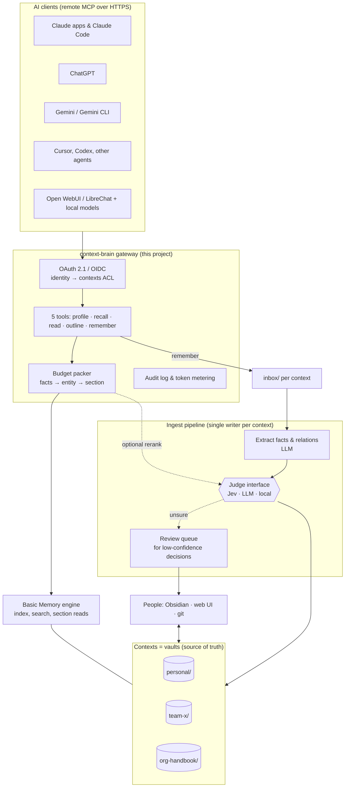

# Decision: how to build context-brain

| | |
|---|---|
| **Status** | Draft for engineering review |
| **Date** | 2026-10-31 |
| **Decision** | Build a thin open-source gateway and ingest pipeline on top of Basic Memory's markdown format, with a pluggable judge (Jev recommended) |
| **Delivery plan** | [plan.md](plan.md) |

*The landscape moves fast. Versions, prices and availability were checked in October 2026. Anything marked **(unverified)** comes from vendor or third-party claims we could not confirm.*

---

## 1. Summary

- **What we decided:** we will not adopt an existing memory product, and we will not build an engine from scratch.
  - We adopt **Basic Memory** (open source) as the storage format and index.
    - It is plain markdown in which atomic facts and typed relations live inside the notes.
    - So the same files serve models, people (in Obsidian or a web UI) and git.
  - We build the part nobody provides properly: a **gateway**. It includes:
    - **Identity and access:** OAuth 2.1 / OIDC sign-in and access control per context.
    - **Five tools** with a token budget for models.
    - An **ingest pipeline** that turns raw notes into deduplicated, attributed, time-bounded facts.
- **Where Jev fits:** the ingest pipeline makes many small yes/no and pick-one judgments. Those go through a **judge interface**.
  - **TypeSafe's Jev** is the recommended judge. It is a non-generative decision model that is cheap, fast and returns calibrated confidence.
  - An **LLM judge** ships alongside it, so the project runs with no proprietary dependency.
- **Hosting:** one container image and one configuration schema cover three hosting profiles:
  - **Personal:** one person.
  - **Organisation:** SSO, many contexts and teams.
  - **Community:** anyone self-hosting.
- **Go/no-go gate:** after the first phase we compare against the managed alternatives on the same evaluation set, before we commit to the larger build.

## 2. Problem and goals

AI assistants now do real work, but the context they work from is fragmented:

- Each vendor's memory is **per user and per product**. Nothing written in one tool is visible to another tool or to a colleague.
- **Group knowledge has no home that models can read.** This means decisions, constraints, conventions, owners and recent changes. People re-explain it in prompts, paste docs, or let each agent rediscover it.
- The common workaround is to load a whole wiki or a long `CLAUDE.md`, which is **token-expensive**. Long contexts also measurably hurt answer quality.
- Vector-store memories are **opaque**. The people a memory describes can't easily see, correct or delete it.

**Goals:**
- One brain per person and per group, usable from any MCP-capable AI client.
- Models retrieve small, relevant, attributed facts within a stated token budget.
- People own the content: they can read it, edit it, delete it and export it as plain files.
- It works for one person, for a team, and for an organisation of hundreds, without forking the code.

**Non-goals for v1:**
- A hosted multi-tenant SaaS. The design must not block one, but we are not building it.
- A chat UI or agent framework. The brain is a service that other tools call.
- Replacing document systems such as Notion, Confluence or Google Drive. They can be *sources* for ingest later.
- Automatic capture from every system (Slack, email, meetings) in v1.

## 3. Requirements

R1–R6 are must-haves. R7–R9 are strong preferences.

| # | Requirement | What "good" looks like |
|---|---|---|
| R1 | **Group brain** | Many people feed one brain that builds up facts about the group. Every fact records who asserted it and where it came from. |
| R2 | **One brain per person, any AI** | The same brain from Claude (web, desktop, mobile, Code), ChatGPT, Gemini, Cursor, other coding agents and local models, across sessions. |
| R3 | **Built for models, token-cheap** | A model pulls only what it needs: facts of about 20–40 tokens first, then the entity, then the source section. Every lookup has a token budget. The tool definitions themselves stay small. |
| R4 | **Human interface to the whole brain** | Browse, organise, edit and delete everything, in Obsidian or a web UI. Edits and deletes reach the search index. |
| R5 | **Isolated, selectable contexts** | Contexts such as `personal`, `team-payments` or `org-handbook`. A session attaches one or several. Who can read or write each context is **enforced**, not just tagged. |
| R6 | **Open and portable** | Open-source code; data is plain files the owner can export. No required proprietary service. |
| R7 | **Absorbs and maintains facts** | Captures facts from conversations and documents, removes duplicates, marks superseded or disputed facts, and keeps valid-from/to dates. |
| R8 | **Privacy and control** | Self-hostable; real deletion; no training on the data; sensitive content is kept out of shared contexts. |
| R9 | **Deployable at three scales** | Personal, organisation and community deployments from the same code, differing only in configuration: identity provider, storage and sync, judge and LLM providers. |

## 4. What the research says

### 4.1 Token efficiency (R3)

- **Benchmarks mostly come from vendors, and they disagree.** For example:
  - Mem0's paper on LoCoMo: full context scored 72.9% at about 26k tokens per query; Mem0 scored 66.9% at about 1.8k; Zep scored 66.0% at about 3.9k.
  - Letta's plain agent with file tools over the raw text scored 74%.
  - The independent MemDelta benchmark found verbatim retrieval close to full context (47.2% vs 49.8%). Changing only the embedding model moved accuracy by 6 points.
- **Takeaway:** simple retrieval over the original text, split into sections, is a strong baseline. LLM fact extraction adds cost and errors. Adopt it only where our own evaluation shows a gain.
- **What actually cuts tokens:**
  - **Small retrieval units.** A fact is about 20–40 tokens; a section is about 300–900.
  - **Section-level reads instead of whole pages.** One published test of an LLM wiki measured 37k tokens to load everything versus 1.9k through section search and reads (author's own numbers).
  - **Hybrid search.** Keyword (BM25) plus vector search, merged and reranked.
  - **A hard token budget per lookup**, filled in rank order.
  - **Progressive disclosure:** a small always-loaded profile, then an outline, then a section, then the page.
  - **Few, short tool definitions.** Each tool definition costs roughly 140–320 tokens of context (unverified).

### 4.2 Facts and graphs versus wiki prose

The question was whether facts stored as a graph beat wiki pages on tokens and speed.

- **A graph is not automatically better.** *Does Memory Need Graphs?* (ACL 2026) found:
  - Graphs help only when they are built well. Entity nodes with descriptions helped; edges based on similarity hurt.
  - Matching a query to entities beats matching it to triples.
  - Following links one hop out adds noise unless the results are reranked.
  - Keeping the raw text **alongside** the extracted facts improved retrieval.
  - Building the graph took about 7× longer than a flat index.
- **Token cost depends on the design, not on using a graph.** Per query:

  | System | Tokens per query |
  |---|---|
  | HippoRAG 2 | ~1k |
  | LightRAG | 5k–100k |
  | Microsoft GraphRAG (global) | ~330k |

- **What a fact layer does buy:**
  - entity-centric access ("everything about the Orders API")
  - multi-step questions
  - time validity
  - duplicate and conflict detection.
- **Conclusion: keep markdown, but make it fact-shaped.** Basic Memory already stores observations (`- [category] fact #tag`) and typed relations (`- depends_on [[Ledger Service]]`) inside ordinary notes. So the graph *is* the markdown, and people can edit it.

### 4.3 Human interface (R4)

- **Obsidian is the best editor for markdown vaults.** It has backlinks, a graph view and mobile apps, plus an official headless sync client for servers.
  - It has **no access control inside a vault**. So the unit of isolation must be **one vault per context**, and the gateway's access-control list maps onto those vaults.
- **For organisations, git per context is the natural sync and audit layer.** Obsidian Sync or Relay fits small groups, and a web UI serves people who won't use Obsidian.
- **Deletes must reach the index.** It is unverified whether deleting a note in Obsidian also removes it from Basic Memory's search index. It gets tested in phase 1, with a scheduled reconcile as a backstop.

### 4.4 Client reach (R2)

- **Remote MCP over HTTPS with OAuth 2.1** is the one surface that every major client now accepts:
  - claude.ai: org connectors on Team and Enterprise.
  - ChatGPT: Business and Enterprise; Plus is unclear.
  - Gemini: currently personal accounts in the US.
  - Also Cursor, Claude Code, Gemini CLI, Open WebUI and LibreChat.
- **No client recalls memory automatically.** Each needs a short instruction ("call `profile` then `recall` first"), or a session-start hook where the harness supports one (Claude Code does).

## 5. Options compared

Key: ● meets · ◐ partly or needs work · ○ no · ? unknown

| Option | Kind | R1 Group | R2 Any AI | R3 Tokens | R4 Human UI | R5 Contexts | R6 Open | R7 Facts | R8 Privacy | Verdict |
|---|---|---|---|---|---|---|---|---|---|---|
| **Basic Memory (self-hosted)** | OSS (AGPL), markdown + graph | ◐ no auth/ACL | ◐ needs OAuth front | ● observations, section reads with `max_tokens` | ● Obsidian | ◐ projects, no ACL | ● | ◐ format, no extractor | ● | **Base layer** |
| Basic Memory Cloud/Teams | Commercial, ~$15–19/seat | ● roles per project | ● | ● | ◐ web UI; local deletes don't sync | ● | ◐ same files | ◐ | ◐ hosted | Managed fallback, low lock-in |
| mcp-memory-service | OSS (Apache) | ◐ tags | ● OAuth + DCR | ◐ | ◐ dashboard | ◐ tags only | ● | ◐ | ● | Quick prototype |
| Memlord | OSS (AGPL), very small | ● shared workspaces | ● OAuth 2.1 | ◐ | ◐ | ● | ● | ◐ | ● | Gateway reference |
| Hindsight | OSS (MIT) | ◐ bearer key | ◐ no OAuth | ● budgeted recall | ○ opaque store | ● | ◐ Postgres | ● | ● | Best engine, fails R4 |
| Graphiti / Zep | OSS (Apache), temporal graph | ○ no isolation | ◐ no auth | ● facts as edges | ○ | ◐ group id | ◐ Neo4j | ● valid-from/to | ● | Copy its fact model |
| Cognee | OSS (Apache), knowledge graph | ● multi-tenant | ◐ | ◐ | ○ | ● | ◐ heavy | ● | ● | Too heavy |
| Mem0 | OSS (Apache) | ◐ | ○ no MCP self-hosted | ● ~1.8k/query | ○ | ◐ | ◐ | ● | ● | Avoid |
| HippoRAG 2 | Research code | ○ | ○ | ● ~1k/query | ○ | ○ | ● | ● | ● | Borrow retrieval idea |
| qmd | OSS (MIT), search | ○ | ◐ no auth | ● hybrid + rerank | ● | ◐ | ● | ○ | ● | Search component |
| LLM-wiki tools (Karpathy pattern) | OSS | ○ | ◐ | ○ index + whole pages | ● | ◐ | ● | ◐ ingest/lint | ● | Borrow layout and lint |
| flow (Facets) | OSS (MIT), alpha | ○ single user | ◐ Claude Code/Codex | ◐ | ◐ terminal | ◐ | ● | ◐ scoop + sweep | ● local | Borrow capture ideas |
| Outline / Docmost | Self-hosted wiki + MCP | ● | ● | ◐ page-level | ● | ● permissions | ◐ DB storage | ○ | ● | Alternative UI |
| Supermemory | Commercial | ● spaces | ● MCP + extension | ◐ vendor claims | ◐ web app | ● | ○ closed | ● | ◐ | Best managed product |
| Shifu (useshifu.com) | Commercial beta, engineering focus | ◐ group context | ◐ coding tools + MCP | ● distilled decisions | ? | ? | ○ hosted | ● distils records | ◐ manual deletion | Candidate source/connector |
| MemoryPlugin, Plurality Context Flow | Commercial | ◐ | ● many platforms | ◐ | ◐ | ● | ○/◐ | ◐ | ◐ | Not for orgs |
| Notion MCP + memory | Commercial | ◐ memories per user | ◐ | ◐ | ● | ● | ◐ proprietary | ◐ | ◐ | Only if already on Notion |
| Vendor-native memory (Claude, ChatGPT) | Built in | ◐ | ○ one vendor | ◐ | ◐ | ◐ | ○ | ◐ | ◐ | Stopgap only |

**Ruled out:**
- Letta and Khoj: agents, not memory layers. We borrow Letta's "core memory block" idea for `profile`.
- MemOS, memU, Memobase, A-Mem, LangMem, the reference MCP memory server: research projects, focused on coding, stalled, or toys.
- Zep and Mem0 cloud APIs: developer APIs, not a brain people can edit.
- Discontinued or churning consumer products.

**Realistic directions:**

| Direction | Build effort | Must-haves met | Main risk | Lock-in |
|---|---|---|---|---|
| **A. Open source + thin build (chosen)** | A gateway, an ingest pipeline and deploy recipes | All, once built | We own security and uptime; extraction quality is on us | None: markdown in git |
| B. Basic Memory Cloud/Teams | Near zero | R1–R5; R6 partly | Pricing and plan changes; a single vendor | Low: same files |
| C. Supermemory | Near zero | R1, R2, R5; R3/R4 partly | Closed engine; export unclear | High |
| D. Shifu | Near zero | R3, R7; others partly or unknown | Engineering-focused beta; hosted only | High until there's an export |

A is the only direction that meets every must-have while keeping the data in the owner's hands. B uses the same files, so starting with A never closes off B.

## 6. Decision

1. **Storage format:** fact-shaped markdown in Basic Memory's format, **one vault per context**, versioned in git.
2. **Engine:** Basic Memory 1.x as the index and section reader. We run it **unmodified, as a separate process**, behind a narrow storage adapter. That keeps AGPL obligations clean (see §10) and leaves room for another engine later.
3. **What we build:**
   - the **gateway**: authentication, access control per context, five tools with a budget, attribution, audit
   - the **ingest pipeline**: a single writer per context that extracts, dedupes, supersedes and lints
   - **deploy recipes** for three hosting profiles.
4. **Judge interface:** every non-generative decision in the gateway goes through one interface.
   - **Jev is the recommended provider.**
   - An LLM provider and a local-model provider ship too.
   - Deployments choose a provider per judgment.
5. **Go/no-go gate** after phase 1: compare against B, C and D on the same evaluation set before building beyond the prototype.

## 7. Architecture



**Key rule:** models never write to the curated files directly. `remember` appends to the context's `inbox/`. A single ingest worker per context promotes inbox items into entity notes, so concurrent writers can't corrupt the vault, and every change is a reviewable git commit. People can edit curated files at any time; the ingest worker treats their edits as authoritative.

### 7.1 Vault layout and note format

```
<context>/
  AGENTS.md        # conventions for this context (read by ingest and lint)
  profile.md       # ~500-token always-loaded summary, compiled by ingest
  index.md, log.md # Karpathy-style index and change log
  raw/             # immutable sources: transcripts, docs, clippings
  inbox/           # unprocessed `remember` writes, with attribution
  wiki/            # curated entity notes (people, services, projects, decisions)
  review/          # items the judge was unsure about, for a human to resolve
```

An entity note (illustrative; the exact attribution syntax will be fixed in phase 1 so it stays valid Basic Memory and readable in Obsidian):

```markdown
---
title: Orders API
type: service
---
# Orders API
Public API for creating and tracking orders. Owned by the payments team.

## Facts
- [constraint] Idempotency keys expire after 24 hours #api (by: alice · src: [[raw/2026-10-12-design-review#Retries]] · from: 2026-10-12)
- [decision] Pagination is cursor-based; offset pagination is deprecated (by: bob · from: 2026-09-01)

## Relations
- owned_by [[Payments Team]]
- depends_on [[Ledger Service]]

## Disputed
- [sla] p99 latency target is 300 ms (by: carol) vs 500 ms (by: dave)
```

Conventions for groups:
- Every fact carries who asserted it, a source link into `raw/`, and valid-from/to dates.
- Conflicting claims go under `## Disputed` with both attributed. They are never silently overwritten.
- Superseded facts get a `to:` date rather than being deleted, so the history stays answerable ("what was the limit before October?").

### 7.2 Model-facing tools

Five tools, about 700 tokens of definitions in total. Long guidance lives in an on-demand `man` resource rather than in the tool descriptions.

```
profile(contexts)                        → ~500-token core block per context, compiled ahead of time
recall(query, contexts?, budget_tokens=1500, detail=facts|snippets|sections)
                                         → ranked hits: id (note#heading), text, author, valid dates;
                                           packed to the budget; reports the omitted count + a cursor
read(id, max_tokens?)                    → one section, cut at a heading boundary, with where to continue
outline(id | context)                    → headings and their token sizes, to plan a read
remember(context, text, about?, source?) → appends to inbox/ with the caller's identity; never edits wiki/
```

`recall` is **fact-first**. It returns facts, then the matching entity summaries, and source sections only when `detail=sections` asks for them. The budget counts everything in the response, metadata included.

### 7.3 Ingest pipeline and the judge interface (where Jev fits)

The ingest worker runs on a schedule or on inbox events. Generating text (fact wording, summaries, the profile) needs an LLM. Most of the other work is **classification**, and that goes through the judge interface:

```
judge.noul(state, statement)          → p(true), confidence     # "is this statement true?"
judge.choice(state, question, options)→ distribution, confidence # pick one of N
judge.score(state, question, levels)  → distribution, confidence # rate on a scale
```

These three question types map directly onto Jev's Noul, Choice and Score. The LLM and local providers implement the same signatures, using structured output and log-probabilities where available.

| Judgment | Question type | Without a judge | Notes |
|---|---|---|---|
| Is this a durable fact worth keeping? | Noul | LLM decides | TypeSafe's memory cookbook does exactly this |
| Which context and which entity note does it belong to? | Choice over a search-produced shortlist | LLM | Search first, then judge |
| Same entity, or a duplicate fact? | Score + Noul | String match or LLM | Entity-alignment cookbook: merge, send to review, or keep separate |
| Does it supersede or contradict an existing fact? | Noul | LLM | Low confidence → `## Disputed` or `review/` |
| **Private or shareable** before it lands in a shared context? | Choice | Nothing checks this today | **The most valuable judgment for organisations** |
| Rerank recall candidates | Noul per candidate | Local cross-encoder reranker | TypeSafe's rerank cookbook reports top-10 accuracy rising from 38% to 62% over BM25 alone (vendor number); to be measured against a local reranker |
| Which attached contexts does a query need? | Noul per context | Search them all | Minor gain |

**Confidence drives automation.** Each judgment has two thresholds per deployment:
- **Above the high threshold:** apply automatically.
- **Between the thresholds:** send to `review/` for a human.
- **Below the low threshold:** drop.

Thresholds are calibrated on labelled examples from the evaluation set, because confidence measures certainty, not correctness.

**Why Jev is the recommended judge:**
- **Fit:** it is built for exactly these typed decisions and returns calibrated probabilities, which is what the threshold scheme needs.
- **Cost:** $0.042 per million input tokens, with output free. An illustrative workload:
  - about 5 judgments per write, at about 2k tokens of state each, is about 10k tokens per write
  - a million writes is then about **$420** in judge cost.
  - Real cost depends on prompt size and is measured in phase 3.
- **Speed and consistency:** a non-generative model avoids long generations and gives the same kind of answer every time. That matters once an organisation's ingest volume is in the thousands of writes a day.
- **Already proven next to this problem:** TypeSafe publishes memory, rerank and entity-alignment cookbooks, and Shifu uses Jev for relevance judgments.

**Why it is not a hard dependency:**
- Jev is **hosted only**, with no open weights. It has been in **early access since September 2026**, so versions change often.
- Data retention is not stated publicly. **(unverified)**
- Some deployments can't send content to an outside API: air-gapped installs, or data-processing rules.
- An open-source project must run with **no required proprietary service** (R6).

So the LLM provider (any OpenAI-compatible or Anthropic endpoint) and a local small-model provider ship as equals. Phase 4 compares all three on the public evaluation set and publishes the results.

**What Jev cannot do:** write the fact text, summaries or the profile. Those always need a generative model, either the deployment's LLM or the calling client's model.

### 7.4 Capture

There are three capture paths, borrowed from the LLM-wiki pattern and from flow:
- **Scoop:** the model calls `remember` during a session when a durable fact comes up.
- **Sweep:** when a session ends, the transcript is posted to `raw/` and the ingest worker mines it for facts the model missed. This works where the harness exposes the transcript, such as Claude Code hooks; elsewhere it is an explicit upload.
- **Session-start hook:** where the harness supports hooks, `profile` and `recall` are called automatically. Elsewhere a one-line instruction in the client's project or system prompt does the same.

## 8. Hosting profiles

The same container image and configuration schema serve every profile. What changes is listed below.

| | **Personal** | **Organisation** | **Community (anyone self-hosting)** |
|---|---|---|---|
| Who | One person, maybe a partner or a small group | A company: many teams, hundreds of people | Individuals and groups running their own instance |
| Runs on | Laptop (stdio MCP for local clients) plus an optional small VPS or tunnel for web clients | The org's container platform (Kubernetes or a VM) inside its network, with a public HTTPS ingress for SaaS AI clients | Docker Compose on a VPS or home server; a Helm chart for those who want it |
| Identity | Built-in OAuth server with a single user, or GitHub sign-in | **OIDC to the org's identity provider** (Okta, Google Workspace, Entra ID). Context access is mapped from IdP groups. | Built-in OAuth server, or any OIDC provider |
| Contexts | `personal` plus a few others | Per team, per project, org-wide handbook, and a personal context per employee | Whatever the operator defines |
| Storage and sync | Local vault + git; Obsidian Sync optional | One **git repository per context** on the org's git host. Branch protection and CODEOWNERS give review of curated files. | Local disk + git; Obsidian Sync or Relay for small groups |
| Human UI | Obsidian | Web UI and git for most people; Obsidian for power users | Obsidian or the web UI |
| Judge provider | Jev or the person's own LLM key | Jev under an org data-processing agreement, **or** the org's approved LLM endpoint, chosen per judgment | Operator's choice; the LLM judge is the default so nothing proprietary is required |
| LLM provider (extraction, summaries) | Any | The org's approved provider or gateway | Any, including local models |
| Ops | None to speak of | SSO, audit log export, backups, retention policies, monitoring, the org's security review | Backups via git |

**Multi-tenant hosting** (one instance serving unrelated organisations) is out of scope for v1. The design keeps a tenant identifier at the top of the context namespace so it can be added later without a data migration.

## 9. Security, privacy and compliance

- **Access control is enforced at the gateway on every call.** A caller sees only the contexts their identity grants, and recall never merges results across contexts the caller can't read. Write permission is separate from read permission.
- **Stored text is untrusted input.** Facts written by one person end up in another person's model context, so memory poisoning and prompt injection are real risks. Mitigations:
  - Every fact carries its provenance.
  - `recall` output is clearly framed as data, not instructions.
  - Writes to shared contexts go through the inbox and the judge, and through review where the deployment requires it.
  - Each context has an allowlist of who may write.
- **Secrets and sensitive data:**
  - Writes are scanned for credentials and refused.
  - The "private or shareable" judgment runs before any write to a shared context.
  - Organisations can add their own data-classification rules.
- **Deletion:**
  - Deleting a note removes it from the index; a scheduled reconcile verifies this.
  - **Git history still holds deleted content.** Deployments with "right to erasure" duties need a history-rewrite procedure or a git host retention policy, and this must be documented, not glossed over.
- **External processors:** a deployment's config lists every outside service that sees content (judge, LLM, embeddings), so a data-protection review can approve it. The default community config sends nothing outside the host except to the LLM the operator configures.
- **Audit:** every tool call is logged with its identity, contexts, token count and IDs returned (not the content), and the log can be exported to the org's SIEM.

## 10. Licensing

- **Basic Memory is AGPL-3.0.**
  - We run it unmodified as a separate service and talk to it over its API or MCP interface.
  - Our gateway is therefore a separate work and can carry a permissive license.
  - If we ever need to modify Basic Memory, those changes must be published under the AGPL, ideally upstream.
- **Proposal:** Apache-2.0 for this repository. It includes a patent grant and is common in enterprise open source.
- **Jev** is a proprietary hosted API, used only through an optional provider plugin. No TypeSafe code is vendored.
- **Needs confirmation** by whoever owns open-source policy in the sponsoring organisation.

## 11. Risks

| Risk | Likelihood | Impact | Mitigation |
|---|---|---|---|
| Fact extraction introduces errors that spread | Medium | High | Raw sources kept alongside facts; human review for low confidence; lint job; attribution on every fact |
| Basic Memory changes direction or stalls | Low–medium | Medium | Storage adapter boundary; the format is plain markdown, so we can re-index with qmd or similar |
| Jev's API, pricing or availability changes | Medium | Low–medium | Judge interface with LLM and local providers; per-judgment provider config |
| Token savings smaller than expected | Medium | Medium | Measured at the phase-1 gate before the large build |
| Clients' MCP support shifts (plans, regions, auth flows) | Medium | Medium | Standard OAuth 2.1 + DCR; track client matrix; stdio for local clients |
| Memory poisoning across a shared context | Medium | High | §9 mitigations; write allowlists; review queue |
| Deletion obligations vs git history | Medium (orgs) | High | Documented erasure procedure; retention settings; option to store `raw/` outside git |
| People don't keep the brain tidy | High | Medium | Ingest does the tidying; review queue kept small by thresholds; a weekly lint report per context |

## 12. What would change this decision

- **Phase 1 results.** If a managed option (B, C or D) matches our prototype on accuracy and tokens, and meets R4–R6 well enough for the sponsoring organisation, we would adopt it and keep this repository as the format, eval set and recipes only.
- **Shifu.** If Shifu gains an export, an editable UI and non-engineering contexts, it becomes a strong candidate, either as a source the ingest pipeline reads or as the engineering context itself.
- **Hindsight.** If Hindsight gains human-editable storage, it could replace Basic Memory as the engine behind the storage adapter.

## 13. Questions for reviewers

1. **Build vs adopt.** Is a thin gateway on Basic Memory the right call, or should we start on Basic Memory Cloud/Teams and build only if it falls short?
2. **Single writer.** Is one ingest worker per context acceptable for latency? `remember` lands in the inbox immediately, but promotion to curated facts is batched.
3. **Jev as the recommended judge.** Is a hosted, early-access model acceptable as the default for the organisation profile, given the LLM fallback? What would legal or security need to approve it?
4. **Git per context** for the organisation profile: right for audit and review, or too heavy for non-engineers?
5. **Erasure.** Which approach to deletion versus git history do we want to commit to?
6. **Licensing.** Apache-2.0 for our code, with Basic Memory kept as a separate AGPL service: any objections?
7. **Scope of v1 capture.** Should v1 include document sources (Drive, Confluence, Notion), or stay with `remember` plus transcript sweep?
8. **Name.** "context-brain" is a working name.

## 14. Sources

- Karpathy, [LLM Wiki gist](https://gist.github.com/karpathy/442a6bf555914893e9891c11519de94f) (Apr 2026)
- [Does Memory Need Graphs?](https://arxiv.org/html/2601.01280) (ACL 2026)
- [Mem0 paper](https://arxiv.org/html/2504.19413): LoCoMo token and accuracy figures
- [Letta: benchmarking agent memory](https://www.letta.com/blog/benchmarking-ai-agent-memory)
- [MemDelta](https://arxiv.org/abs/2606.29914), an independent memory benchmark
- [When to use graphs in RAG](https://arxiv.org/pdf/2506.05690) (HippoRAG 2, LightRAG and GraphRAG token costs)
- [Anthropic: writing tools for agents](https://www.anthropic.com/engineering/writing-tools-for-agents)
- [Basic Memory](https://github.com/basicmachines-co/basic-memory): [knowledge format](https://docs.basicmemory.com/raw/concepts/knowledge-format.md), [MCP tools](https://docs.basicmemory.com/reference/mcp-tools-reference), [Teams](https://docs.basicmemory.com/teams/about)
- [Hindsight](https://github.com/vectorize-io/hindsight), [Graphiti](https://github.com/getzep/graphiti), [Cognee](https://github.com/topoteretes/cognee), [Mem0](https://github.com/mem0ai/mem0), [HippoRAG](https://github.com/osu-nlp-group/hipporag), [qmd](https://github.com/tobi/qmd), [mcp-memory-service](https://github.com/doobidoo/mcp-memory-service), [Memlord](https://github.com/MyrikLD/memlord), [flow](https://github.com/Facets-cloud/flow)
- LLM-wiki implementations: [nashsu/llm_wiki](https://github.com/nashsu/llm_wiki), [lucasastorian/llmwiki](https://github.com/lucasastorian/llmwiki)
- Jev / TypeSafe: [docs](https://docs.typesafe.ai/introduction), [OpenRouter overview](https://openrouter.ai/blog/insights/what-is-jev/), cookbooks for [memory](https://docs.typesafe.ai/cookbooks/basic_memory.md), [rerank](https://docs.typesafe.ai/cookbooks/rerank_typesafe.md) and [entity alignment](https://docs.typesafe.ai/cookbooks/entity_alignment.md)
- [Shifu](https://useshifu.com), [Shifu data handling](https://useshifu.com/data)
- [Supermemory](https://supermemory.ai/pricing), [Notion MCP](https://www.notion.com/help/notion-mcp)
- Obsidian: [Sync collaboration](https://obsidian.md/help/sync/collaborate), [headless sync](https://obsidian.md/help/sync/headless)
- Client support: [Claude custom connectors](https://support.claude.com/en/articles/11175166), [Gemini custom MCP apps](https://support.google.com/gemini/answer/17209137)
